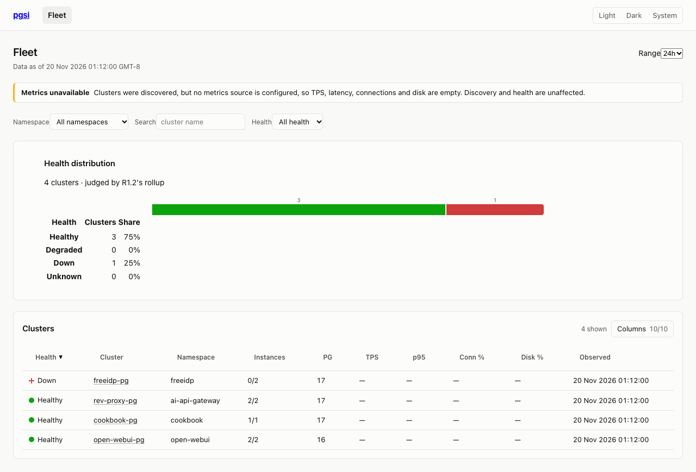

# pgsql-insights

`pgsi` — Cloud SQL Query Insights and System Insights, for PostgreSQL clusters that
run on Kubernetes under CloudNativePG instead of inside Google Cloud.

One Go binary. It serves the API, the metrics and the web UI from the same port, so
there is one thing to install and one thing to authenticate. It is **read-only**: it
runs no SQL that changes anything, and the single exception the spec allows
(`pg_terminate_backend()`, R4.5) is a Phase 6a button, not a background job.

**Status.** The per-phase table with owners and validation entries is
[`IMPLEMENTATION.md`](IMPLEMENTATION.md); the requirements themselves are
[`requirements.md`](requirements.md) (v0.3.0) — that file is the contract, this
README is the shop window. Its legend (⬜ not started · 🔄 in progress · ✅ done ·
⚠️ done with deviations) applies here too:

> **0** ⚠️ done with deviations (§5) · **1a** 🔄 A1 · **1b** ✅ the SPA · **2** 🔄 A1 ·
> **3** ⬜ A1 · **4** 🔄 A2 (chart half is A4's) · **5** 🔄 A2 · **6a** ⬜ A1 ·
> **6b** ⬜ A2 · **7** ⬜ A2 · **8** ⬜ A1 · **9** 🔄 A4 docs — this README's refresh
> is R14.3.

Two of those rows lag commits that already exist, and the shop-window version says so
rather than repeating the table: §3 has **Phase 3 ⬜** while `f7b197e` shipped its query
DTOs and the four `testdata/api` fixtures R16.8 requires with them, and **6b ⬜** while
`67a299d` shipped the Queries table (R10.6). Both are A1's and A2's rows to move, and
R14.9 says one entry per owner, so this README reports the gap instead of editing their
rows.



The screenshot is the Playwright baseline itself (`web/e2e/__snapshots/`), not a
separate asset — so the image in this README and the image CI compares against are
one file, and the README cannot show a UI that the code no longer renders. It is
1280 px wide, which is R10.13's minimum supported width rather than a typical
monitor.

---

## Quickstart — two commands

```sh
helm install pgsi ./chart -n pgsi --create-namespace
make verify
```

`make verify` port-forwards `svc/pgsi` and curls `/healthz`, `/api/v1/version` and
`/metrics` through the Service — the same check R11.14's acceptance runs and the same
one `helm test pgsi` runs from the chart's own test hook. Then open
`http://localhost:8080/`.

From a source checkout without Helm, the equivalent is one command:

```sh
make build && ./bin/pgsi serve --auth=none   # :8080 — API, /metrics and the SPA
```

`--auth=none` is required on the command line, not optional: R8.8's default auth mode
is `token` and the binary fails closed rather than accepting an empty bearer, so a
bare `./bin/pgsi serve` exits 2 (see [IMPLEMENTATION.md §5-D14](IMPLEMENTATION.md)).
The chart passes the flag for you; running the binary by hand does not.

Subcommands are `serve | collect | api | version` (R3.1). **v1 ships exactly one
working role, `serve`** ([IMPLEMENTATION.md D9](IMPLEMENTATION.md)); `collect` and
`api` are reserved stubs that exit cleanly so the CLI surface is stable from Phase 0.

## Install the chart

```sh
# Default profile (values.yaml IS the shipped default — R11.12)
helm install pgsi ./chart -n pgsi --create-namespace

# The other two named profiles are documented deltas, not replacements
helm install pgsi ./chart -n pgsi --create-namespace -f chart/values-production.yaml
helm install pgsi ./chart -n pgsi --create-namespace -f chart/values-lab.yaml

# No Helm? The plain manifests are generated and committed (R11.13)
kubectl apply -f deploy/plain-yaml/all.yaml
kubectl apply -k deploy/kustomize
```

`make render` regenerates `deploy/plain-yaml/` from the chart for all three profiles;
CI runs `make render-check` and fails if the committed files are stale, which makes the
generated manifests the golden test for R11.13 and R16.4.

### What the chart renders (default profile)

`ServiceAccount`, namespaced `Role` + `RoleBinding` (R12.1's verb set, R12.3 — a
`ClusterRole`/`ClusterRoleBinding` appear **only** with `rbac.allNamespaces=true`),
`ConfigMap`, `PersistentVolumeClaim` (RWO, R11.15), `Deployment` (`strategy: Recreate`
because an RWO volume cannot attach to two pods), `Service` (`ClusterIP :8080`, port
named `http`), `ServiceMonitor`, and a `helm test` pod that curls `/healthz` through the
Service (R16.4). Ingress, NetworkPolicy and PodDisruptionBudget templates exist and are
off by default; `values-production.yaml` turns on ingress and the NetworkPolicy.

Both probes are `httpGet` — the image is distroless, which has no shell, so an exec
probe cannot run (R11.2). The pod runs as uid/gid 65532 with a read-only root
filesystem, `/tmp` as an `emptyDir`, all capabilities dropped, `seccompProfile:
RuntimeDefault` (R12.7).

The chart's own reference — every value, the three profiles, the ServiceMonitor/PodMonitor
contract (R9.9) and the cardinality budget (R9.10) — is [`chart/README.md`](chart/README.md).

## Images

```sh
make image            # buildx --platform linux/amd64,linux/arm64 --push (R11.2)
make image-size       # R11.4 compressed size report, gated at 100 MB
make push-local       # both platforms → 10.10.111.134:5000, no docker login needed
```

The `Dockerfile` is multi-stage: `FROM --platform=$BUILDPLATFORM golang:1.26-alpine`
cross-compiles with `GOOS/GOARCH` (no QEMU), and the runtime stage is
`gcr.io/distroless/static:nonroot` pinned by digest with `USER 65532:65532` (R11.3,
R11.5). Both base digests are OCI **index** digests covering both required platforms.

Measured R11.4 size: **3.28 MiB compressed for `linux/amd64`**, 3.05 MiB for
`linux/arm64` — the registry's own manifest numbers, not `docker save | wc -c`. The
SPA's gzipped JS (90.8 kB) is a separate CI number.

### Provisional image registry (open question Q6)

The spec has not settled the registry organisation (Q6), so the working value
throughout this repo is `ghcr.io/frankellis/pgsql-insights`. It appears in `Makefile`
(`IMAGE`), `chart/values.yaml` (`image.repository`) and `.github/workflows/ci.yml`
(`IMAGE_REPO`), each marked provisional. Changing it later is a three-line change plus
a chart version bump — nothing else references the org. Until the org exists, the
verifiable install paths are the packaged chart tarball
(`helm package chart && helm install pgsi pgsi-0.1.0.tgz`) and the reference
environment's own registry, `10.10.111.134:5000/frankellis/pgsql-insights` —
`docker push` needs credentials this dev machine does not have for ghcr.io, so
`scripts/push-oci.py` publishes through the registry v2 API instead
([IMPLEMENTATION.md §5](IMPLEMENTATION.md)).

---

## Capability matrix vs Cloud SQL

The row set is the parity checklist from
[`docs/research/cloud-sql-insights.md` §8](docs/research/cloud-sql-insights.md), which
was written against Google's own product inventory rather than against a guess at it.
Status is per requirement, not per row's existence: a row can be *specified* (the
requirement is written and frozen) and *not built* at the same time, and saying so is
the difference between a matrix and a brochure.

| Capability | Cloud SQL | pgsi | Requirement | Phase |
|---|---|---|---|---|
| Fleet / cluster list | per-project instance list | all CNPG clusters across namespaces, with a health rollup | R10.4 | **1b ✅** |
| Cluster overview (query load, resource load, instances, replication, storage, config, findings) | instance overview | ✅ built — R10.5's two graphs, not Cloud SQL's one four-series chart | R10.5 | **1b ✅** |
| Query list + fingerprint + per-query stats | Query Insights agent | `pg_stat_statements` + normalizer + store | R3.1–R3.8, R10.6 | 3 / 6b |
| Query detail (text, stats, plan, tags) | side panel | header, per-minute load chart, latency table, plan samples | R10.7 | 6b |
| Query normalization (literals → `$1`) | PG ≤10 `?`, PG 11+ `$n` | mirrors both rule sets and keeps the raw sample beside the digest; text length 256–100 000 B, default 1 024 | R3.4, R3.5, R3.6 | 3 |
| Load attribution (CPU / IO / lock) | `insights/aggregate/*` | exec vs plan time, `blk_read_time`/`blk_write_time`, `wait_event_type` | R3.7, R9.4 | 2 |
| Wait events | `backends_in_wait` | `wait_event_type` × `wait_event` rollup, drilling to the sessions in each | R4.3, R10.9 | 6a |
| Latency percentiles | `aggregate/latencies` distribution | R3.9's sampled histogram (8 buckets + `_sum`/`_count`) | R3.9, R9.13 | 6b |
| Query plans | `auto_explain`, N/min | `auto_explain` log parse + plan store | R3.10 | 6b |
| Active queries (top 50) | Active Queries tab, 60 s refresh | the same top-50 list, refreshed at **15 s** — the query is cheaper than Cloud SQL's, so it can be fresher | R4.1, R4.2, R10.8 | 6a |
| Terminate a session | terminate button | `pg_terminate_backend()`, behind `--allow-actions` (default **false**), a confirmed UI action and an audit record — the one write pgsi performs | R4.5 | 6a |
| Blocking chain | lock graph | `pg_catalog.pg_blocking_pids(pid)`, not a manual `pg_locks` join, expanded inline on the session row | R4.4, R10.8 | 6a |
| Idle-in-transaction vs active, `backend_type` | — | pgsi separates the two ages and surfaces autovacuum / parallel / walsender backends, so a 4 h idle session is not drawn as a 4 h query | R4.6, R4.7 | 6a |
| OS metrics | `database/{cpu,memory,disk,network,swap}/*` | cAdvisor / node-exporter — **a superset**: cpu system/user/iowait, anonymous/buffered/slab memory, per-device IO | R5.3, R9.7 | 2 / 7 |
| DB metrics | `database/postgresql/*` | the `pg_stat_*` set CNPG's instance manager already exposes on `:9187`, re-exported under `pgsi_` | R5.2, R9.7 | 2 / 7 |
| System Insights dashboard + compare-up-to-5 | System Insights | summary cards, and comparing up to 5 instances on one chart (R5.7) | R5.7, R10.10 | 7 |
| Chart toolbar: zoom, **Download PNG**, **Download CSV**, "View in Prometheus/Grafana" | export | all four, on every chart | R5.6 | 7 |
| Events timeline | `sql#operation` events | CNPG cluster events + `kubectl get events` + role changes | R5.9 | 8 |
| HA / replication | `replica_byte_lag`, `replication/state` | `pg_stat_replication` byte/time lag + CNPG instance roles | R10.5, R5.5 | **1b ✅** |
| Tags (sqlcommenter / OTel) | `pertag` | parse the SQL comment, key by `tag_hash` | R3.12, R9.6 | 6b |
| Connection pooling insights | `conn_pool/*` + `ConnectionPoolConfig` | pgbouncer `SHOW POOLS/CLIENTS/SERVERS` from CNPG Pooler clusters | R6.1–R6.5, R10.11 | 8 |
| Retention | 7 d (EE) / 30 d (EEP) | configurable retention + downsampling | R3.14, R5.8 | 3 / 7 |
| REST API | `cloudsqladmin` + `databaseinsights` MCP | `/api/v1/*` + a committed OpenAPI document + the **PromQL pair** mirroring the MCP's `get_query_metrics` / `get_system_metrics` | R8.1–R8.11 | 5 |
| Alerting | Cloud SQL's own alerting | `PrometheusRule` with a `critical` tier CNPG's `cnpg-default-alerts` lacks, every rule linked to a runbook | R9.11, R13.6 | 4 ✅ / 9 ✅ |
| AI-assisted troubleshooting | Gemini investigations (Preview) | **out of scope for v1** — R7.1's index advisor and R7.3's rightsizing are post-0.1 (spec §11) | — | — |

Two honest gaps in the row set. **Query plans** and **tags** are specified in detail
and built at Phase 6b, so today the Queries page is a route with a phase on it, not a
table of queries. **AI-assisted troubleshooting** is the one Cloud SQL feature the
spec declines to clone at all, and says why.

---

## Metrics catalogue (R14.7)

R14.7 requires every exported metric to be documented in one place, and R9.1 requires
the prefix: everything is `pgsi_` (configurable via `metrics.prefix`) so nothing
collides with the `cnpg_`, `pg_` and `container_` families already in a shared
Prometheus. R9.3 fixes the label contract — every series carries `namespace`,
`cluster`, `pod` and `instance_role`; pooler series add `pooler`, database series add
`datname`, user series add `usename` — which is what keeps a dashboard written today
working after a second instance is added.

R9.1's two-plane rule decides what is a metric at all: **numbers go to `/metrics`,
text goes to the API.** Query text, plan bodies, active-session rows and blocking
chains are never Prometheus labels — a label per query is how a 5 000-query cluster
buys a 40 GB TSDB.

| Family | Requirement | Series / cluster | Ships in | |
|---|---|---|---|---|
| `pgsi_build_info{version,commit}` | R11.3, R9.8 | 1 | **1a — served today** | ✅ |
| `pgsi_up{namespace,cluster,pod,instance_role}` | **R9.12** | 1 per instance | 2 | `1` when our last collection round for that instance succeeded; 0.1.0 had `pgsi_scrape_target_up` (CNPG up) and no metric for *us* |
| Aggregate — execution time, rows, shared hits/reads per (cluster, db, user) | R9.4 | ~1 200 | 2 | always on |
| Per-query, **top-N only** (`metrics.topN`, default 50/cluster, 0–1000, 0 disables) | R9.5, **R9.5b** | 300 | 3 | labelled by `fingerprint`, with `queryid` as a secondary label — R3.4 exists because `queryid` is unstable across a PG 17→18 upgrade, and labelling the family with `queryid` alone forks every saved PromQL query on upgrade |
| Sampled latency histogram | R9.13 | 450 | 6b | 50 × (8 buckets + `_sum` + `_count`); a histogram over *sampled* durations, not a true distribution, and §5 counts it as such |
| Per-tag | R9.6 | tags × databases | 6b | only when R3.12 tags are enabled |
| System (the full R5.2 set + parsed `cnpg_*` re-exported) | R9.7 | ~4 000 | 2 (partial) → 7 (complete) | |
| Pooler | R6.1 | ~200 | 8 | only where a Pooler exists |
| Self-observability: `pgsi_collector_duration_seconds`, `pgsi_collector_errors_total`, `pgsi_scrape_target_up`, `pgsi_store_size_bytes`, `pgsi_http_request_duration_seconds`, `pgsi_scheduler_queue_depth`, `pgsi_scheduler_shed_total` | R9.8 | ~120 | 2 | |

**What this costs**: 24 480 series and ≈1.59 GB over 30 days for the four reference
clusters. The number is derived three ways — computed from §5's table, measured against
the reference Prometheus, and (once `scripts/cardinality-check.py` lands) asserted in
CI — in
[`chart/README.md` §Cardinality budget](chart/README.md#cardinality-budget-r910).
That section also records the spec's own two conflicting figures (R13.4's 23.7 k/1.5 GB
vs §5's table, which sums to 24 280) rather than quietly picking one.

### API surface (R8.2)

| Route | | |
|---|---|---|
| `GET /` | The SPA, from `go:embed` in this same binary | R10.1, R8.6 — **1b ✅** |
| `GET /healthz`, `GET /readyz` | Liveness and readiness; never auth-gated under any `--auth` (R8.9's ruling — a gated readiness probe is a pod that never goes Ready) | R8.7 — **1a ✅** |
| `GET /api/v1/version` | Version + commit | R8.7 — **1a ✅** |
| `GET /api/v1/clusters` | The fleet list; `{data, meta}` envelope, `meta.total` is the pre-cut count | R8.2, R8.4 — **1a ✅** |
| `GET /api/v1/clusters/{namespace}/{name}` | One cluster's detail — the payload `ClusterDetailPage` renders | R8.2 — **5 ✅** |
| `GET /api/v1/insights/queries/series` | Batched per-minute series for up to 50 fingerprints. This is what the Query Detail chart reads: `QueryDetailView` has no `points` field, because the dto package cannot import `api.QuerySeries` without closing an import cycle (`internal/api/dto/queries.go:11-34`) | R8.11 — **5 ✅** |
| `GET`/`POST /api/v1/metrics/query` · `GET`/`POST /api/v1/metrics/system` | R8.3's PromQL pair — four patterns, mounted by `internal/api/promql.go` | R8.3 — **5 ✅** |
| `GET /metrics` | `pgsi_build_info` today; the R9.4/R9.5 families from Phase 2 | R11.3 — **1a ✅** |
| `GET /debug/pprof/*` | Five patterns (`/`, cmdline, profile, symbol, trace); follows `--auth` (R8.9) | R8.7 — **1a ✅** |
| The 17 routes still planned | Named in [`api/x-planned-paths.yaml`](api/x-planned-paths.yaml)'s `r8.2-catalogue`. An entry is *promoted* into `paths` when its phase registers it and deleted here — the two sets are disjoint by rule, which is what makes "documented but not built" checkable instead of a claim | 3–8 |

Every ✅ above means the same thing: the route is registered in
`internal/api/server.go` as committed. That is also exactly what the generator walks —
`internal/api/openapi_gen.go`'s `RouteTable()` is a go/ast pass over the package's
route registrations — and its `checkRouteTable` is what enforces R14.7's two directions
in one pass: a route in code with no entry in the document, and an entry in the document
claiming a route that is not registered. So a route may be documented and not built (it
lives in `x-planned-paths`, which `paths` excludes by construction), but it cannot be
built and undocumented. `scripts/check-openapi.py` is the other half — it validates the
document itself (duplicate keys, dangling `$ref`s, missing operationIds, non-`/api/v1`
paths) rather than the route table. The Phase column
names the phase that *owns* the route, which is not the same as that phase being
closed: `GET /api/v1/clusters` is registered and serving while Phase 1a itself is
still 🔄 in §3.

The full contract — schemas, the ten-member error-code enum, pagination — is
[`api/openapi.yaml`](api/openapi.yaml), and since `9794560` that file is **generated**
(R8.1b): `internal/api/openapi_gen.go` writes it and `openapi_gen_test.go`
byte-compares the committed copy against its output, so an edit the generator does not
reproduce fails `go test ./internal/api` and `make openapi-check`. Change the
generator's inputs — the routes, the dto types, the prose in
`internal/api/openapi_annotations.go`, or `api/x-planned-paths.yaml` — not the
document.

---

## Reference environment

k3s v1.37.2+k3s1, 5 nodes (all `linux/amd64`), CNPG 1.30.0, four PostgreSQL clusters.
Full probe record: [`docs/research/live-probe.md`](docs/research/live-probe.md).
Compatibility claims and their evidence: [`docs/compatibility-matrix.md`](docs/compatibility-matrix.md).

The reference cluster's Prometheus (kube-prometheus-stack in `monitoring`) only selects
ServiceMonitors labelled `release: prom-operator`; set
`metrics.serviceMonitor.additionalLabels` accordingly (the default `{}` works on
clusters with a permissive selector).

## Repository layout

```
cmd/pgsi/             single binary, subcommand dispatch (R3.1, R11.1)
internal/api/         HTTP handlers: /healthz, /readyz, /api/v1/{clusters,version}, /metrics, / (SPA)
internal/kube/        the per-port transport table (R1.10) — A1's Phase 1a
internal/discovery/   cluster + instance discovery (R1.1–R1.9) — A1's Phase 1a
internal/version/     ldflags-injected Version/Commit (R11.3)
web/                  the React SPA; dist/ is committed and go:embed'd (R10.1)
chart/                the Helm chart (R11.6, R11.7, R11.12)
deploy/plain-yaml/    generated manifests, all three profiles (R11.13)
deploy/kustomize/     kustomization pointing at the generated default profile
Dockerfile            multi-stage, distroless, pinned digests (R11.2, R11.3, R11.5)
Makefile              local mirror of CI (R11.11)
.github/workflows/    CI (R11.11, R11.16)
docs/                 architecture, runbooks, research, reviews, licenses, ENVIRONMENT
testdata/             the API contract fixtures the Go and TS tests share (R16.8)
```

## License

[Apache-2.0](LICENSE). Dependency manifest: [`docs/licenses/`](docs/licenses/).
